# Stable-Island — Stablecoin Dynamic Island

**Stable-Island** is a React Native fintech portfolio piece showcasing the Dynamic Island concept for stablecoin applications. It demonstrates how complex, asynchronous on-chain states — cross-chain bridging, gasless transfers, yield compounding, and global remittance — can be handled fluidly through a persistent status overlay without interrupting the user's primary flow.

---

## What This Is

A fully functional mobile app that simulates a non-custodial MPC wallet settlement layer. Every screen has a real form with validation, balance deduction, fee disclosure, and address validation. When a transaction is submitted, a Dynamic Island-style overlay tracks the pipeline from burn through attestation to mint — with live progress, stage-specific colors, and auto-dismiss.

The app runs and interacts end-to-end; what is *not* real is on-chain settlement (see the table below).

---

## What's Real vs Simulated

| Feature | Status |
|---------|--------|
| Island morph animation (size, spring physics, cutout positioning) | **Real** — Reanimated springs tuned to approximate the native feel |
| Island overlays the actual hardware cutout | **Real** — `top = max(inset - 48, 8)`, status bar hidden while expanded |
| Peg monitoring (USDC/USDT prices, 30s poll, halt guard) | **Real** — CoinGecko API calls; shows an offline banner when the feed is unreachable; EURC/PYUSD are static display values |
| FX rates (NGN, KES, GHS, EUR, BRL, INR, PHP) | **Real** — `open.er-api.com` every 30s + on rate-lock expiry; static fallback if unreachable |
| Base Mainnet RPC badge (block number, gas) | **Real** — live `eth_blockNumber`/`eth_gasPrice` calls; offline fallback is labeled as such |
| Forms, validation, balance math, fee disclosure | **Real** — client-side logic, runs fully |
| Transaction pipeline (Burn → Attest → Mint) | **Simulated** — timed stage machine; no chain writes, no wallet signing |
| Settlement & transaction hashes | **Simulated** — generated locally |
| MPC wallet / custody layer | **Simulated** — local balance deduction only |
| Gasless / paymaster fee waiver | **Simulated** — presentation only |
| Yield APYs (Aave/Compound/Morpho) | **Static** — hardcoded in source, not fetched |
| Native Dynamic Island handoff (ActivityKit) | **Not wired** — see "Next: Native Dynamic Island Handoff" |

---

## Video Demos

### iOS (Dynamic Island device)


https://github.com/user-attachments/assets/39a42360-2069-4a29-a59d-72f67da5354b


### Android


https://github.com/user-attachments/assets/14e665c1-58f2-460c-b160-a89f58f9f4ff


---

## Stablecoin Concepts Implemented

### Cross-Chain Transfer (CCTP Pipeline)
Real-time simulation of the Burn → Attest → Mint pipeline used by protocols like Circle's CCTP. Each stage has its own timing, progress tracking, and visual treatment. The island overlay shows the current stage with a progress bar and percentage.

### Gasless Paymaster Transfers
Paymaster-style gasless UX where the network fee is abstracted away from the user. Fee disclosure shows the actual gas cost hidden behind a "gasless" label, with the real cost visible in the breakdown. (Fee presentation is simulated; no ERC-4337 bundler or paymaster is invoked.)

### Global Remittance (USDC → Fiat)
A 4-step form simulating USDC-to-fiat remittance with live exchange rates, a real 30-second rate lock (the payout is snapshotted at the locked rate and only re-quotes on expiry), and a 1% spread applied to the payout and disclosed before confirmation. The flow includes recipient details, bank selection, and a confirmation step with fee disclosure showing network fee + FX spread + total cost.

### Yield Deposits
Deposit flow into yield vaults (Aave v3, Morpho, Compound) with gas cost disclosure. The vault selector shows APY rates, and the confirmation includes the estimated gas cost.

### Live Peg Monitoring
A depeg warning system that polls CoinGecko every 30 seconds for USDC and USDT prices (EURC and PYUSD are static display values). Three alert thresholds:
- **0.5% deviation** → Yellow warning banner
- **2% deviation** → Red critical alert
- **5% USDC deviation** → Submissions on Send, Bridge, FX, and Yield are disabled until the peg recovers

If CoinGecko is unreachable, the banner switches to an offline "peg unverified" state (with the age of the last successful fetch) rather than presenting last-known prices as verified.

### On-Chain RPC Inspector
Block number and gas price (gwei) fetched live from Base Mainnet RPC, displayed as a badge in the app header. If the RPC is unreachable, the badge shows an offline/estimated state instead of presenting stale data as live.

---

## Screenshots (IOS Device)

### Dynamic Island: USDC Transfer Pipeline
*Instead of trapping users on a blocking loading screen, the Dynamic Island tracks standard stablecoin transfers ambiently. As the transaction processes on-chain, the user sees live state changes (Burning → Settled) directly in the pill, freeing them to continue using the app.*

| Burning | Expanded Details | Settled |
|---------|------------------|---------|
|  | 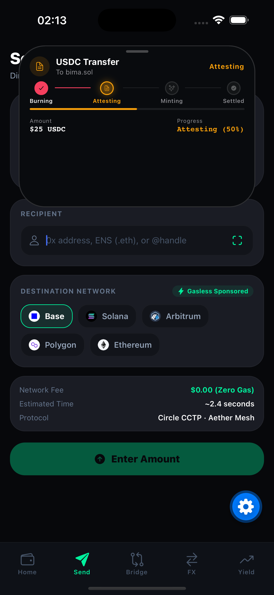 | 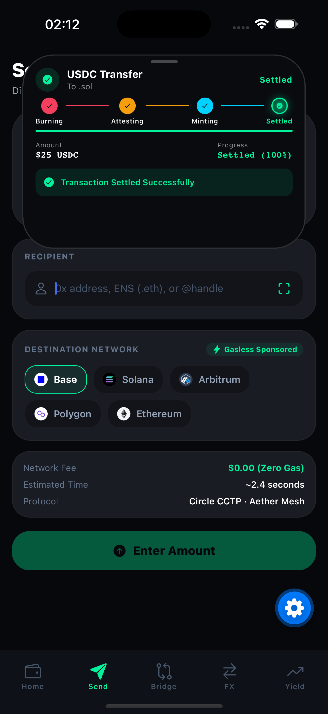 |

### Dynamic Island: Cross-Chain Bridging
*Cross-chain transfers via protocols like CCTP involve multi-minute, multi-stage pipelines (Burn → Attest → Mint). The Island overlay perfectly manages this complex asynchronous process, giving users real-time visibility into bridging status without interrupting their flow.*

| Bridge Form | Island Overlay |
|-------------|----------------|
| 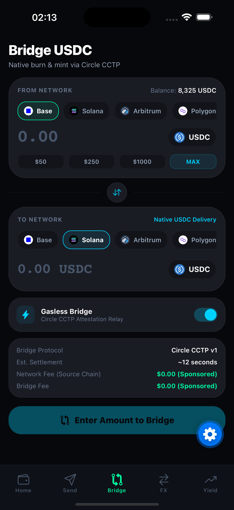 | 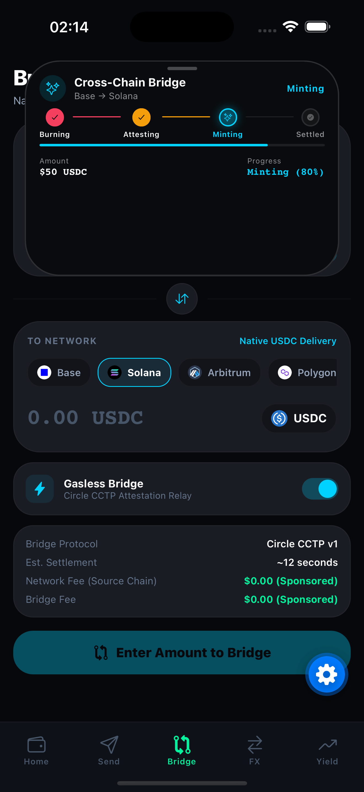 |

### Dynamic Island: Global Remittance (USDC → Fiat)
*Converting crypto to fiat involves locking an FX rate and waiting for off-chain fiat rails to settle. The expandable island provides a persistent, interactive receipt that updates live as the funds move across borders.*

| FX Form | Island Overlay | Expanded View |
|---------|----------------|---------------|
| 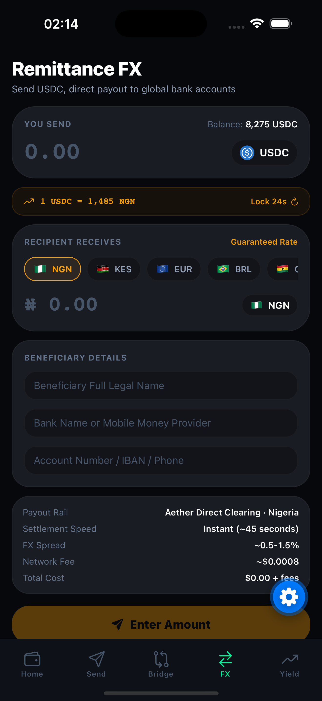 | 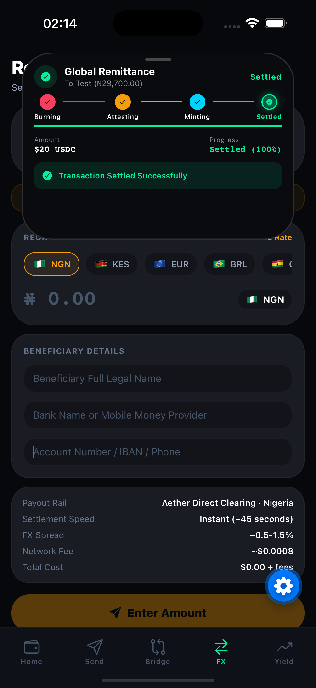 | 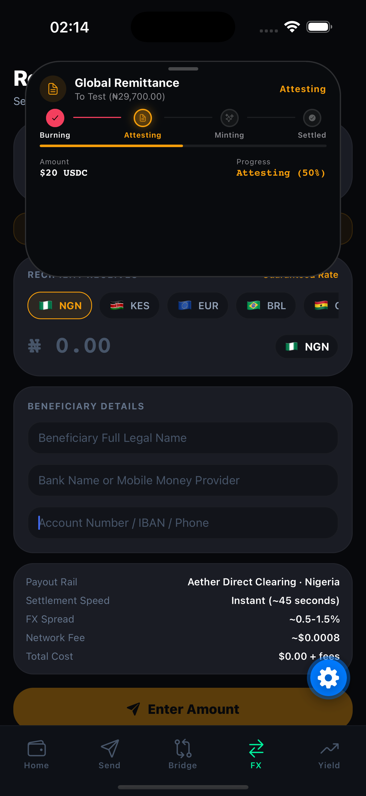 |

### Core App Screens & Validation
*Stable-Island is built as a complete wallet experience. It includes robust forms, address validation, and interactive yield dashboards, all integrated with the island overlay.*

| Portfolio Dashboard | Yield Deposit |
|---------------------|---------------|
| 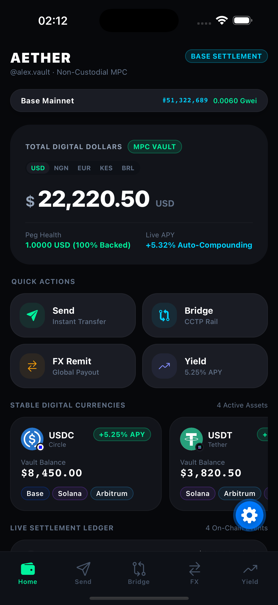 | 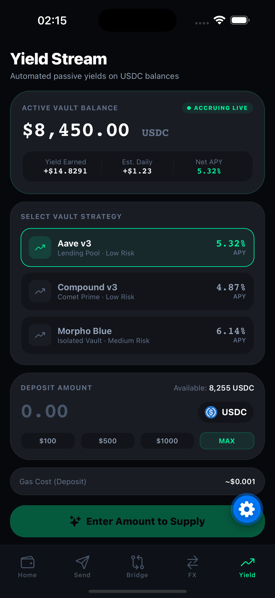 |

| Address Validation | Island Minimal (pill) |
|-------------------|-----------------------|
| 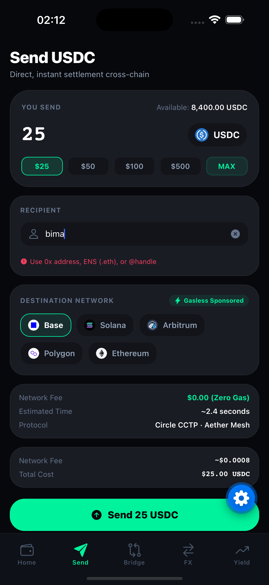 | 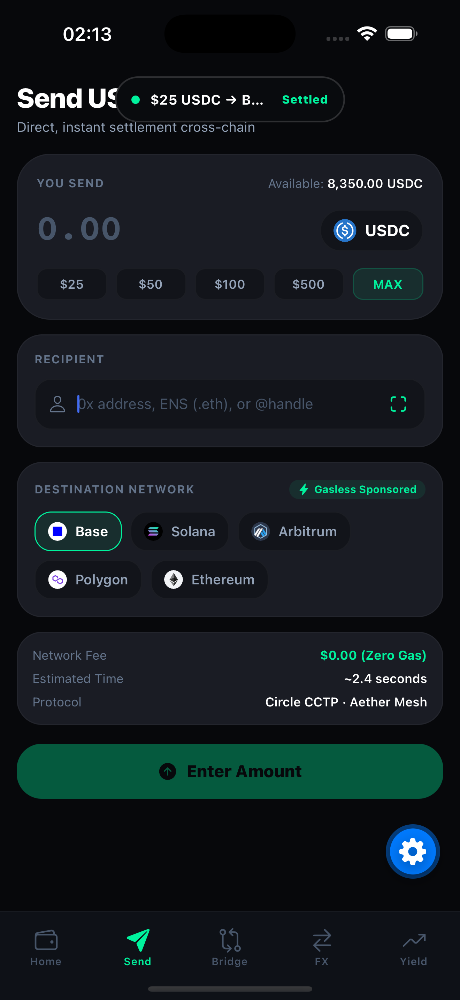 |


---

## Design Inspiration

The core interaction model is directly inspired by Apple's native Dynamic Island on iPhone 14 Pro and later. Apple's implementation proves that persistent, ambient status updates — music playback, timers, FaceID — can live in a non-intrusive pill at the top of the screen without disrupting the user's primary task.

Stable-Island applies this same principle to stablecoin transactions. Where Apple shows a timer counting down, Stable-Island shows a cross-chain bridge burning tokens on Base and attesting on Solana. The interaction grammar is identical: a compact pill that expands on tap to reveal detail, then collapses back when dismissed. The difference is that Stable-Island's island is built entirely in React Native using Reanimated spring physics, not native UIKit — proving that the concept translates beyond iOS-native apps.

---

## Next: Native Dynamic Island Handoff

The current implementation uses an in-app overlay that mimics the Dynamic Island's behavior. It has **not** been verified on-device as a native Live Activity. The next step is a native handoff — when the user backgrounds the app during an active transaction, the status would transfer to Apple's real Dynamic Island via ActivityKit and WidgetKit.

Scaffolding that exists today:
1. **Expo config plugin** (`plugins/withStableIslandActivity.js`) — sets Info.plist keys and the App Group entitlement
2. **Swift source stubs** (`modules/stable-island-activity/ios/`) — widget and Live Activity view code

What is **not** done (why this is "Next", not "Done"):
- No Widget Extension target is wired into the Xcode project, so the Swift code is never compiled into a runnable app
- No end-to-end run on a physical Dynamic Island device

Remaining work:
1. **WidgetKit Extension target** renders the Live Activity in the Dynamic Island with compact, minimal, and expanded states
2. **App Group** file sharing between the app and the widget extension
3. **JS API** (`startActivity`, `updateActivity`, `endActivity`) mirroring the in-app transaction lifecycle

The data model (`TransactionAttributes`) is designed to carry the same fields the in-app island uses — title, subtitle, type, stage, and progress — so the handoff can be seamless. This is the natural evolution of the concept: the in-app overlay proves the interaction model works, and the native extension would make it persistent beyond the app's lifecycle.

---

## Architecture

### Navigation
Expo Router file-based routing with 5 tabs: Portfolio, Send, Bridge, FX, Yield.

### State Management
Zustand store (`src/store/useStableStore.ts`) managing:
- Multi-currency balances (USDC, USDT, EURC) with live deduction
- Transaction lifecycle (start → stage updates → complete/fail → dismiss)
- Flow state per screen
- Ledger history

### Design System
Single source of truth for design tokens:
- `src/design-system/tokens/colors.ts` — `COLORS` and `RADIUS` constants
- Dark-mode-first with deep blacks (`#07080B`, pure `#000000` on the island)
- No emoji anywhere in the UI — all icons via `@expo/vector-icons`

### Island Overlay
A transaction status overlay (`src/components/island/StableIsland.tsx`) that clones the system Dynamic Island:
- Pure-black 37pt capsule (radius = height / 2), flush with the hardware cutout inside the safe area
- Compact state shows leading indicator + trailing value only — the center is reserved for the sensor housing, like the real island
- Expanded state (160pt) uses ActivityKit-style regions: top band flanking the cutout, title/subtitle below, segmented stage progress, stage + elapsed-time footer
- Appears automatically when a transaction is submitted; auto-expands on start
- Auto-collapses 4.5s after settlement, 5s after failure
- Single Reanimated spring (`ISLAND_SPRINGS.morph`, ζ ≈ 0.75) drives width/height/radius in lockstep for an Apple-like morph with subtle bounce

### Performance
- `React.memo` on all display components
- `useCallback` for referentially stable callbacks
- Native Reanimated shared values for UI-thread animations
- Zustand selectors to minimize re-renders

---

## Tech Stack

| Layer | Technology |
|-------|-----------|
| Framework | Expo SDK 57, React Native 0.86.3 |
| Navigation | Expo Router (file-based) |
| State | Zustand |
| Animation | React Native Reanimated 4.x |
| Language | TypeScript 6.0 (strict mode) |
| Icons | Ionicons via `@expo/vector-icons` |

---

## Getting Started

### Requirements
- Node.js >= 18
- iOS Simulator or Android Emulator

### Installation

```bash
git clone https://github.com/boluwatifee4/RN-in-app-dynamic-island-concept-for-stablecoin-apps.git
cd RN-in-app-dynamic-island-concept-for-stablecoin-apps
npm install
npx expo start
```

Press `i` for iOS, `a` for Android, `w` for Web.

---

## Project Structure

```
src/
├── app/                    # Expo Router screens
│   ├── _layout.tsx         # Root stack + island overlay
│   └── (tabs)/
│       ├── _layout.tsx     # Tab navigator
│       ├── index.tsx       # Portfolio dashboard
│       ├── send.tsx        # USDC transfer
│       ├── bridge.tsx      # Cross-chain bridge
│       ├── fx.tsx          # Global remittance
│       └── yield.tsx       # Yield deposit
├── components/
│   ├── island/             # Dynamic Island overlay
│   ├── ledger/             # Dashboard cards
│   └── ui/                 # Shared UI components
├── design-system/
│   └── tokens/             # Colors, radii
├── features/
│   └── island-engine/      # Physics hook
├── services/               # RPC, FX, market data
├── store/                  # Zustand store
└── constants/              # Types, currencies, chains
```

---

## License

MIT © 2026
